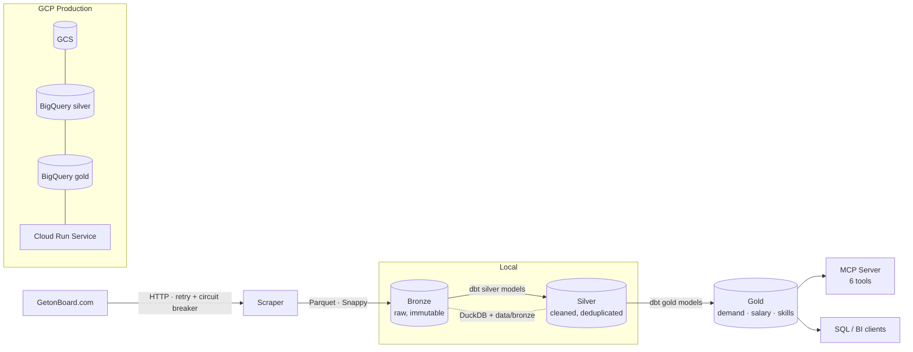

# GCP Data Engineer Demand Pipeline

[](https://github.com/LiliValGo/gcp-data-engineer-demand-pipeline/actions/workflows/ci.yml)

An end-to-end batch pipeline that tracks demand for **data engineering roles in the Latin American job market**, using [GetonBoard](https://www.getonbrd.com) as the source.

It runs fully local (DuckDB + Parquet) and deploys to GCP (BigQuery + Cloud Storage + Cloud Run), with the same codebase on both — only the dbt target and storage backend change.

---

## Why this exists

Job postings are a noisy, semi-structured signal: salaries arrive in mixed currencies, locations are free text, and the same role is titled ten different ways. This project turns that raw feed into three analytics tables that answer concrete questions:

- Which roles are in demand over time?
- What is the salary distribution per role and city?
- Which skills appear most often in data engineering postings?

The resulting Gold layer is also queryable from an LLM through an **MCP server**, so the analysis can happen conversationally.

---

## Architecture



- **Bronze** — raw, immutable Parquet files, Hive-partitioned by role and run timestamp (`role=data_engineer/2026-04-09T10-00-00__v2.parquet`), plus a metadata sidecar with lineage and quality metrics.
- **Silver** — cleaned, deduplicated `silver.jobs`: normalized salary (currency converted), parsed location, canonical role, extraction confidence score.
- **Gold** — `gold.demand_by_role`, `gold.salary_trends`, `gold.skills_frequency`, modeled in dbt.

Full detail: [docs/ARCHITECTURE.md](docs/ARCHITECTURE.md) · [docs/MEDALLION.md](docs/MEDALLION.md) · [docs/MCP.md](docs/MCP.md).

---

## Design decisions & trade-offs

| Decision | Why | Trade-off |
|---|---|---|
| **DuckDB locally, BigQuery in prod** | Zero cloud cost for development; same medallion model everywhere | ~90% SQL compatibility, so a handful of models need a profile switch |
| **dbt for Silver → Gold** | One set of models runs on DuckDB *and* BigQuery — no duplicate transformation code | Adds a dependency and a compile step vs. plain Python SQL |
| **Medallion layers** | Bronze is replayable; each layer has a single responsibility | More storage and more moving parts than a single script |
| **Idempotent checkpoints** (DuckDB URL store) | Re-running the scraper never reprocesses the same URL | One more state store to keep in sync with Bronze |
| **Per-field confidence scoring (0.0–1.0)** | Makes extraction quality measurable instead of assumed | Requires rules per extraction method |
| **Schema versioning (`JobV1` → `JobV2`)** | Schema evolves without breaking historical Bronze files | Version has to travel with each Parquet file |
| **Cloud Run Job (batch) + Cloud Run Service (MCP)** | Right compute primitive per workload; scale to zero | Two deployables to operate |
| **Terraform + Secret Manager** | Reproducible infra; no secrets in the image or repo | Infra changes require a Terraform run |

---

## Tech stack

`Python 3.13` · `dbt` (duckdb / bigquery) · `DuckDB` · `Parquet / PyArrow` · `Pydantic` · `BeautifulSoup` · `pytest` · `Docker` · `Terraform` · `GCP` (BigQuery, Cloud Storage, Cloud Run, Artifact Registry, Secret Manager, Cloud Logging) · `Model Context Protocol`

---

## Quick start (local)

```bash
# 1. Create and activate a virtual environment
python -m venv venv && source venv/bin/activate

# 2. Install dependencies
pip install -r requirements.txt   # or: make install

# 3. Run the full pipeline (scrape → Bronze → Silver → Gold)
python main_scraper.py            # or: make scrape

# 4. Start the MCP server (Claude queries the Gold layer)
python run_mcp.py                 # stdio
# or, on macOS sandboxed environments:
MCP_TRANSPORT=sse PORT=8000 python run_mcp.py   # or: make run-mcp
```

Configuration is read from `.env` — copy `.env.example` and fill in your values.

```bash
make test      # run the test suite
make dbt-run   # run dbt models against local DuckDB
make seed      # seed Silver + Gold with demo data
```

---

## GCP deployment

### 1. Build and push the container image

```bash
gcloud auth print-access-token \
  | docker login -u oauth2accesstoken --password-stdin https://us-central1-docker.pkg.dev

docker build --platform linux/amd64 \
  -t us-central1-docker.pkg.dev/YOUR_PROJECT_ID/job-market-pipeline/scraper:latest \
  -f Dockerfile.scraper .

docker push us-central1-docker.pkg.dev/YOUR_PROJECT_ID/job-market-pipeline/scraper:latest
```

### 2. Provision infrastructure

```bash
cd infra
terraform init
terraform apply -var="project_id=YOUR_PROJECT_ID"
```

Terraform provisions GCS, BigQuery datasets, Cloud Run, Artifact Registry, Secret Manager and IAM.

### 3. Run the scraper job

```bash
gcloud run jobs execute job-scraper --region us-central1
```

---

## Project structure

```
├── scraper/
│   ├── models.py          # JobV2 Pydantic schema
│   ├── client.py          # HTTP client with retry + circuit breaker
│   ├── parser.py          # BeautifulSoup extraction
│   ├── exporter.py        # Bronze Parquet writer
│   ├── checkpoint.py      # DuckDB-backed idempotency store
│   ├── quality.py         # Data-quality rules + confidence scoring
│   ├── medallion.py       # Bronze → Silver → Gold (Python)
│   ├── config.py          # Pydantic Settings
│   └── logging_config.py  # Structured JSON logging
├── transform/             # dbt project (silver + gold models, tests, profiles)
├── mcp_server/            # FastMCP server with 6 tools (queries + on-demand scrape)
├── role_mapper/           # Fuzzy + keyword canonical role normalization
├── infra/                 # Terraform: GCS, BigQuery, Cloud Run, Scheduler, IAM
├── tests/                 # pytest suite
├── docs/                  # architecture, medallion and MCP references
├── main_scraper.py        # pipeline entry point
├── run_mcp.py             # MCP server entry point
└── requirements.txt
```

---

## Testing

```bash
pytest tests/ -v
```

The suite covers the extraction model, parser quality scoring, role normalization, checkpoint idempotency, the medallion transformations, and the MCP tools (`tests/test_*.py`). CI runs the full suite on every push and pull request via GitHub Actions.

---

## Data model (Gold)

| Table | Grain | Columns |
|---|---|---|
| `gold.demand_by_role` | date × role | `date`, `canonical_role`, `job_count` |
| `gold.salary_trends` | role × city | `canonical_role`, `city`, salary percentiles |
| `gold.skills_frequency` | role × skill | `canonical_role`, `skill`, `mention_count` |

### Query examples

```sql
-- Top demanded roles
SELECT * FROM gold.demand_by_role ORDER BY date DESC, job_count DESC LIMIT 10;

-- Salary distribution for data engineers
SELECT * FROM gold.salary_trends WHERE canonical_role = 'data_engineer';

-- Most-mentioned skills
SELECT skill, mention_count
FROM gold.skills_frequency
WHERE canonical_role = 'data_engineer'
ORDER BY mention_count DESC
LIMIT 15;
```

---

## Limitations & next steps

- Single source (GetonBoard); adding more boards would require a per-source parser behind the current client interface.
- Silver deduplication keys on URL hash — reposted listings are intentionally treated as new postings.
- Gold models are fully refreshed; at larger volumes they would move to incremental/`MERGE` materializations.
- No alerting yet on scrape failures; structured logs are Cloud Logging-ready but thresholds are not wired.

---

## License

MIT
